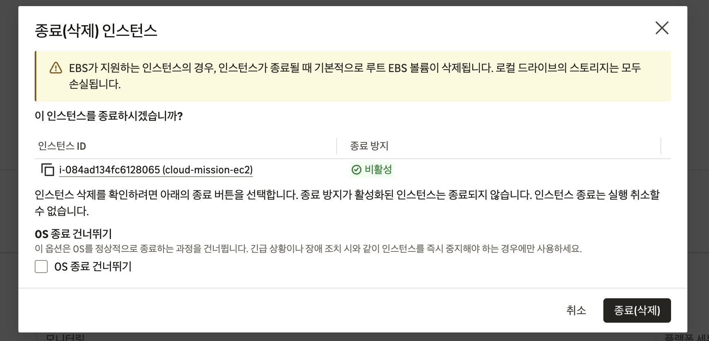
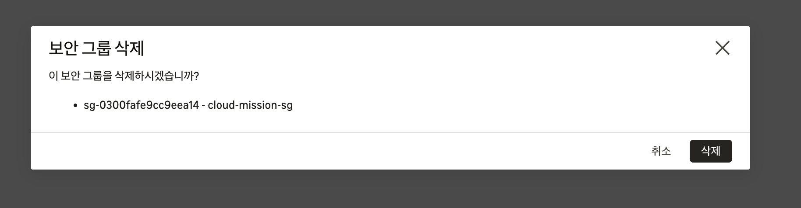

# 실습 리소스 정리 체크리스트

> **현재 상태: 미정리 — 실습 완료 후 실행 필요.** 아래 체크박스는 실제 삭제 확인 전에는 체크하지 않습니다. 체크만으로 과금 중단을 보증할 수 없으며 Billing에서 별도 확인해야 합니다.

- AWS 계정: `933479670289` / 리전: **ap-northeast-2**
- 실습 IAM 사용자: `cloud-mission-user`
- 정리 시각: `미기록`
- 담당자: `미기록`

## 0. 삭제 전

- [x] 제출 증빙 및 README/다이어그램/트러블슈팅 보고서 로컬 저장
- [x] 외부 접속·SSH·내부 curl 등 필요한 검증 완료
- [x] 다른 프로젝트 리소스가 아닌 **이번 실습용** 이름·ID인지 확인

## 1. 컴퓨팅·스토리지 (우선)

- [x] EC2 인스턴스(`cloud-mission-ec2`) **인스턴스 종료(Terminate)** 후 상태 `terminated` 확인. `Stop`만으로는 종료/정리 완료가 아님
- [x] EC2 > 볼륨에서 해당 인스턴스의 루트 EBS 8GiB gp3가 함께 삭제되었는지 확인 (Delete on termination 설정 확인)
- [x] 남아 있는 **미연결 EBS 볼륨** 및 불필요한 스냅샷이 있는지 검사 후 실습 생성분만 삭제
- [x] EC2 > 탄력적 IP에서 실습용 Elastic IP 할당이 없는지 확인. 할당했다면 연결 해제 후 Release

## 2. 네트워크 리소스

- [x] Security Group `cloud-mission-sg` (`sg-0300fafe9cc9eea14`) 삭제
- [x] Public Route Table `cloud-mission-public-rt` (`rtb-0332f0539d0a18fd0`)에서 서브넷 명시적 연결 해제 후 라우팅 테이블 삭제 (필요 시 먼저 IGW 경로 삭제)
- [x] Internet Gateway `cloud-mission-igw` (`igw-049b12df927b4380b`)를 VPC에서 Detach 후 삭제
- [x] Public Subnet `cloud-mission-public-subnet` (`subnet-0026b21adac78d547`) 삭제
- [x] VPC `cloud-mission-vpc` (`vpc-00da42d4c2cbd3ebc`) 삭제. AWS가 종속 기본 리소스를 함께 정리하는지 확인

## 3. 비용 및 증거

- [ ] 관리자 권한으로 Billing & Cost Management에서 오늘·이번 달 EC2, EBS, 퍼블릭 IPv4, NAT Gateway 등 비용 확인
- [ ] 청구 데이터 반영 지연 및 이미 발생한 비용 가능성 이해; 삭제가 과거 사용료를 지우지는 않음
- [ ] 정리 후 리소스 목록 스크린샷 또는 삭제 완료 ID/시간 기록

## 삭제 로그 (실행 후 작성)

| 리소스 | 삭제/확인 시각 (KST) | 결과 / 근거 |
| --- | --- | --- |
| EC2 / EBS | 미실행 | 미확인 |
| Elastic IP / 공인 IPv4 | 미실행 | 미확인 |
| Security Group | 미실행 | 미확인 |
| Route Table / Subnet | 미실행 | 미확인 |
| Internet Gateway | 미실행 | 미확인 |
| VPC | 미실행 | 미확인 |
| NAT / ELB / RDS | 미실행 | 존재 여부 재확인 필요 |
| Billing | 미실행 | 미확인 |
